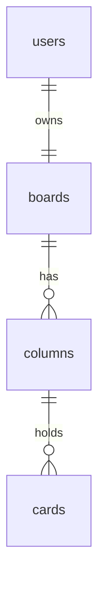

# Database

SQLite through Python's built-in `sqlite3` module. No ORM. Full schema: [schema.json](schema.json).

## Tables

- `users` - `id`, `username`. No password column: sign in stays hardcoded for the MVP.
- `boards` - one per user (`user_id` is UNIQUE).
- `columns` - `title` and `position` (0-based order).
- `cards` - `column_id`, `title`, `details` and `position` (0-based, contiguous within a column).

Foreign keys cascade on delete, so deleting a column removes its cards.

## IDs

Columns and cards use text ids generated by the backend: `col-<hex>` and `card-<hex>`, from `uuid4`. These are sent to the frontend as-is, so the API needs no id mapping. The prefix also keeps column ids and card ids distinct, which the drag-and-drop code relies on. Users and boards use integer ids, which are never exposed.

## API shape

`GET /api/board` returns the same `BoardData` shape the frontend already uses: `columns` in position order, each with ordered `cardIds`, plus a `cards` map keyed by id. It is built from two queries (columns ordered by position, cards ordered by column and position).

## Ordering

A move takes `column_id` and `position`. The backend removes the card from its old column, inserts it at the new index, and rewrites `position` for the affected columns in one transaction.

## Lifecycle

- DB file: `DB_PATH` env var. The default is `backend/kanban.db` locally; in Docker it is `/data/kanban.db` on the `pm-data` volume, so data survives restarts.
- Every connection runs `CREATE TABLE IF NOT EXISTS`, so the DB file and tables are created on first use.
- The first time a user's board is requested, the user row and a default board are created. The default board has the five columns (Backlog, Discovery, In Progress, Review, Done) and the current sample cards.
