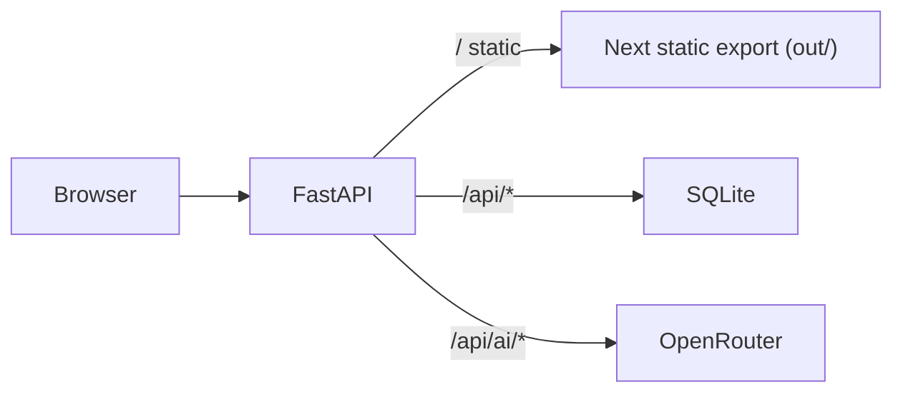

# Project Plan

## Architecture

- One Docker container on port 8000. A multi-stage Dockerfile: the Node stage runs `next build` with `output: "export"`; the Python stage uses uv (`uv sync`, `uv run uvicorn`).
- FastAPI serves API routes under `/api` and mounts the static export at `/` with `StaticFiles(html=True)`.
- `.env` (with `OPENROUTER_API_KEY`) is passed to the container with `--env-file`.
- SQLite file lives on a named Docker volume so data survives restarts.
- AI: `openai` Python SDK pointed at `https://openrouter.ai/api/v1`, model `openai/gpt-oss-120b`.

## Testing conventions

- Backend: `uv run pytest` in `backend/`.
- Frontend unit: `npm run test:unit` in `frontend/`.
- Frontend e2e: `npm run test:e2e` in `frontend/`. From Part 3 on, Playwright runs against the container at `http://127.0.0.1:8000`.
- A part is done when its checklist is checked, all tests pass, and the app works manually via the start script.

---

## Part 1: Plan

- [x] Enrich this document with substeps, tests and success criteria for each part
- [x] Create `frontend/AGENTS.md` describing the existing frontend code
- [x] User reviews and approves this plan

Success criteria:
- User has approved the plan.

## Part 2: Scaffolding

- [x] Create `backend/` as a uv project (`pyproject.toml`, `uv.lock`) with `fastapi` and `uvicorn`
- [x] `backend/app/main.py`: FastAPI app with `GET /api/health` returning `{"status": "ok"}`
- [x] Serve a temporary `backend/static/index.html` "hello world" page at `/` that calls `/api/health` and shows the result
- [x] `Dockerfile` at the project root (Python stage only for now) using uv, running uvicorn on port 8000
- [x] `.dockerignore` (exclude `node_modules`, `.next`, `.venv`, `.env`, test output)
- [x] `scripts/start.sh`, `scripts/stop.sh` (Mac/Linux) and `scripts/start.ps1`, `scripts/stop.ps1` (Windows): build image, run detached as `pm` with `--env-file .env`, port 8000 and a named data volume; stop removes the container
- [x] Update `backend/AGENTS.md` and `scripts/AGENTS.md`

Tests:
- [x] pytest: `/api/health` returns 200 and `{"status": "ok"}`
- [x] pytest: `/` returns the hello world HTML

Success criteria:
- Running the start script, then opening `http://localhost:8000` shows the hello world page with the API response.
- The stop script stops and removes the container.

## Part 3: Add in Frontend

- [x] Set `output: "export"` in `frontend/next.config.ts`
- [x] Add a Node build stage to the Dockerfile that runs `npm ci && npm run build`, and copy `frontend/out` into the Python stage
- [x] FastAPI mounts the exported site at `/` (after `/api` routes); remove the hello world page
- [x] Point Playwright `baseURL` at `http://127.0.0.1:8000` and drop the `npm run dev` web server

Tests:
- [x] Existing Vitest tests pass
- [x] Existing Playwright tests pass against the container (load board, add card, drag card)
- [x] pytest: `/` returns HTML containing the app, `/api/health` still works

Success criteria:
- The demo Kanban board is displayed at `http://localhost:8000/` from the container.

## Part 4: Fake user sign in

- [x] Backend: `POST /api/login` checks `user` / `password` and sets an httponly signed session cookie; `POST /api/logout` clears it; `GET /api/me` returns the username or 401
- [x] Frontend: on load call `/api/me`; show a login form if 401, otherwise the board
- [x] Login form (username, password, purple submit button, error message on bad credentials)
- [x] Logout button in the board header

Tests:
- [x] pytest: login success sets cookie; bad credentials return 401; `/api/me` with and without cookie; logout clears session
- [x] Vitest: login form renders, submits, shows error on failure
- [x] Playwright: visiting `/` shows login; bad credentials show error; good credentials show board; logout returns to login; session persists across reload

Success criteria:
- The board is only visible after signing in with `user` / `password`, and logging out hides it.

## Part 5: Database modeling

- [ ] Propose schema: `users`, `boards` (one per user), `columns` (board_id, title, position), `cards` (column_id, title, details, position)
- [ ] Save the schema as `docs/schema.json`
- [ ] Document the approach in `docs/DATABASE.md` (stdlib `sqlite3`, no ORM, tables created and default board seeded on first access, DB file path)
- [ ] User reviews and signs off

Success criteria:
- User has approved the schema.

## Part 6: Backend

- [ ] `backend/app/db.py`: connect, create tables if missing, seed user and default board (5 columns, sample cards) on first access
- [ ] `GET /api/board`: board for the signed-in user in the frontend `BoardData` shape
- [ ] `PATCH /api/columns/{id}`: rename column
- [ ] `POST /api/cards`: create card in a column
- [ ] `PATCH /api/cards/{id}`: edit title and details
- [ ] `DELETE /api/cards/{id}`: delete card
- [ ] `POST /api/cards/{id}/move`: move to `column_id` at `position`, reordering positions
- [ ] All routes require a session and only touch the user's own board

Tests:
- [ ] pytest with a temporary DB file for each test
- [ ] DB is created when missing and seeded once
- [ ] Each route: happy path, 401 without session, 404 for unknown ids
- [ ] Move: within a column and across columns, positions stay contiguous

Success criteria:
- All board operations persist in SQLite and survive a server restart.

## Part 7: Frontend + Backend

- [ ] `frontend/src/lib/api.ts`: typed fetch helpers for each board route
- [ ] `KanbanBoard` loads the board from the API instead of `initialData`
- [ ] Rename, add, delete and move call the API and update local state
- [ ] Add card editing: click a card to edit title and details inline, save via API
- [ ] Column rename is saved on blur or Enter (not every keystroke)

Tests:
- [ ] Vitest: components with mocked `fetch` (load, rename, add, edit, delete, move)
- [ ] Playwright: each operation survives a page reload; edit a card; drag a card and reload

Success criteria:
- The board is fully persistent: every change remains after reload and container restart.

## Part 8: AI connectivity

- [ ] Add `openai` dependency; `backend/app/ai.py` creates a client with the OpenRouter base URL and `OPENROUTER_API_KEY`
- [ ] `POST /api/ai/test`: asks "What is 2+2?" and returns the model reply

Tests:
- [ ] pytest (mocked client): route returns the mocked reply
- [ ] pytest (live, skipped when no key): reply contains "4"

Success criteria:
- A live call through the container returns a reply containing "4".

## Part 9: AI with board context and Structured Outputs

- [ ] `POST /api/ai/chat` with `{message, history}`
- [ ] Build messages: system prompt describing the board and rules, board JSON, conversation history, user message
- [ ] Request Structured Outputs using a Pydantic model `{reply: str, board_update: BoardData | null}`
- [ ] If `board_update` is present, validate it and save it to the user's board
- [ ] Return `{reply, board_updated: bool}`

Tests:
- [ ] pytest (mocked client): reply only leaves the board unchanged; board update creates, edits and moves cards and is persisted; history and board JSON are included in the request
- [ ] pytest (live, skipped when no key): asking to add a card results in a new card in the DB

Success criteria:
- Asking the AI to create, edit or move cards changes the persisted board correctly.

## Part 10: AI chat sidebar

- [ ] `ChatSidebar` component: collapsible right sidebar with message list, input and purple send button, using the project color scheme
- [ ] Keeps conversation history in state and sends it with each message
- [ ] Loading state while waiting for the AI
- [ ] When `board_updated` is true, re-fetch `/api/board` so the board refreshes automatically

Tests:
- [ ] Vitest: sends message, renders reply, shows loading, triggers board refresh when `board_updated` is true
- [ ] Playwright with mocked `/api/ai/chat`: chat round trip and board refresh
- [ ] Manual live check: ask the AI to add and move cards and see the board update

Success criteria:
- A user can chat with the AI in the sidebar, and AI-driven board changes appear immediately.
